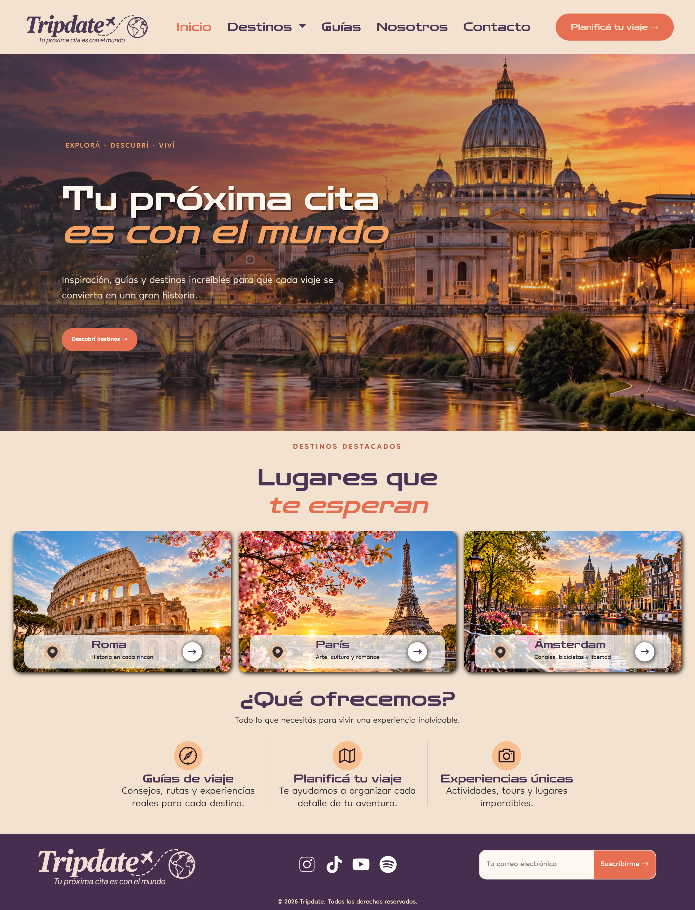

# Tripdate ✈️

**Tripdate** es un proyecto de desarrollo web orientado al turismo y los viajes. Su objetivo es ofrecer una experiencia visual atractiva para descubrir destinos, consultar guías de viaje y conocer más sobre el proyecto.

## 📌 Características

- **Inicio:** presentación del sitio y acceso a sus principales secciones.
- **Destinos:** selección visual de destinos turísticos.
- **Guías de viaje:** contenido pensado para ayudar a organizar viajes.
- **Nosotros:** información sobre el proyecto.
- **Contacto:** sección para facilitar la comunicación con los usuarios.
- **Diseño responsive:** adaptación de la interfaz a distintos tamaños de pantalla.

## 🛠️ Tecnologías utilizadas

- **HTML5:** estructura y contenido de las páginas.
- **CSS3:** estilos y diseño visual.
- **Sass (SCSS):** organización, reutilización y mantenimiento de los estilos.
- **Bootstrap:** componentes y herramientas para agilizar el desarrollo responsive.
- **Git y GitHub:** control de versiones y alojamiento del repositorio.

## 📁 Estructura del proyecto

```text
proyecto26/
├── index.html
├── pages/
│   ├── destinos.html
│   ├── guias.html
│   ├── nosotros.html
│   ├── contacto.html
├── scss/
│   ├── base/
│   ├── components/
│   ├── layout/
│   └── utilities/
├── css/
│   └── styles.css
└── img/
```

## 🚀 Cómo ejecutar el proyecto

1. Clonar el repositorio:

   ```bash
   git clone https://github.com/gjuar/proyecto26.git
   ```

2. Entrar en la carpeta del proyecto:

   ```bash
   cd proyecto26
   ```

3. Abrir `index.html` en el navegador o utilizar la extensión **Live Server** de Visual Studio Code para visualizar la web durante el desarrollo.

### Compilar Sass

Si trabajás con archivos SCSS, podés compilar los estilos con Sass:

```bash
sass --watch scss/main.scss styles/styles.css
```

Ajustá las rutas del comando si tu archivo principal o la carpeta de salida tienen otros nombres.

## 🎯 Objetivo del proyecto

Este proyecto forma parte de mi aprendizaje y práctica en desarrollo web. Busca aplicar conocimientos de maquetación, diseño responsive, organización de estilos con Sass y desarrollo de interfaces utilizando Bootstrap.

## 👨‍💻 Autor

Desarrollado por **gjuar**.

- GitHub: [@gjuar](https://github.com/gjuar)


## 🌐 Vista web

- https://gjuar.github.io/proyecto26/

## Preview


